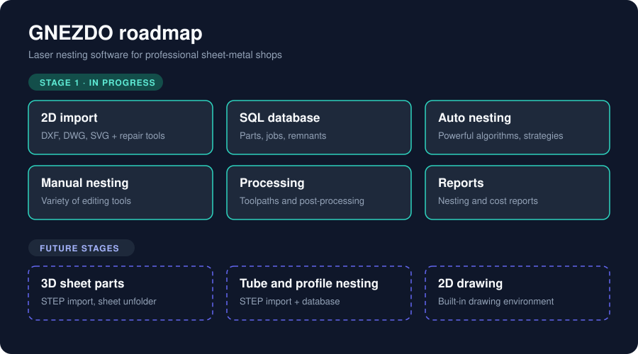

<div align="center">

# GNEZDO

**Laser nesting software built by a metal-shop engineer, for metal shops.**

Run it as a web app on your work server, or as a desktop app on Windows and Linux.

*In development: usable for importing parts and nesting; cutting paths and reports come next.*


[**⬇ Download test build**](#download-a-test-build) ·
[**Test parts**](https://github.com/M0ti0n/GNEZDO/raw/main/test-parts/TEST_PARTS_FOR_GNEZDO.7z) ·
[Roadmap](#roadmap) ·
[Run on a server](#run-on-the-server-docker)


</div>

---

## Why GNEZDO?

Users work in the browser. Parts, jobs and nests live in SQL Server, or on a personal PC when using the desktop version.

I work as a mechanical engineer in a metal processing company. The commercial nesting software we used was expensive, fragile and poorly supported, so I decided to build my own: one I would actually enjoy using. It is based on my experience with many nesting programs over the years and shaped around the workflow I use every day.

It is meant for professional industrial shops, not just hobbyists.

*Why the name?* Every "nest" and "nesting" name was already taken, and "gnezdo" means "nest" in my language. :)

## Features

Working now:

- **Part import from DXF** (files or whole folders, dropped anywhere), with cutting, tracing (engraving), open cut, hole and common cut lines detected from layers and colors, and editing tools for fixing broken parts: geometry check, trim, extend, line, align, erase, sweep, color lines, measuring
- **Database** of parts, jobs and projects (SQL Server on a server, SQLite in the desktop version), with part versions that can be restored, part search and job search
- **Auto nesting** with Fast, Thorough and Custom strategies, blocks, common cut, continuing a solution, and several solutions side by side
- **Manual nesting** with add sheet, mirror, rotate, arrange, stack, align edge, common cut, lock, copy and paste
- **Work part list** with materials, thicknesses, required / nested / maximum quantities and stock sheets, including remnants from DXF
- **Server version** with users and sign-in, and a **desktop version** for one PC

Coming:

- **Part import from DWG and SVG**
- **Remnant database**
- **Processing and post-processing**: cut order, lead-ins, toolpaths and machine-specific features
- **Nesting and cost reports**

## Roadmap



**Stage 1 (currently implementing)**

- [ ] 2D import with powerful, easy-to-use tools for fixing broken parts: DXF and the repair tools done; DWG and SVG to follow
- [x] SQL database for parts and jobs (remnants to follow)
- [x] Job creation with auto nesting algorithms and strategies: Fast, Thorough and Custom work; tuning goes on
- [x] Manual nesting with a variety of tools: the core tools are done
- [ ] Processing and post-processing tools for path generation and special features
- [ ] Nesting reports and cost reports

**Future stages**

- [ ] Import 3D parts from STEP files with a sheet unfolder
- [ ] Tube and profile nesting with STEP import and database
- [ ] 2D drawing environment

## Screenshots

### Job: auto nesting


Automatically arranges imported parts onto the available material sheets to improve material utilization and reduce waste. Supports several nesting strategies (Fast, Thorough, Custom) to balance speed and quality, and shows multiple sheet solutions with material usage statistics for easy comparison.

### Job: manual nesting


An interactive workspace for positioning parts on material sheets by hand. Includes tools for mirroring, rotating, arranging, stacking and aligning, and shows the available job parts and sheet dimensions.

### Job: work part list


All parts assigned to a production job in one list: names, materials, thicknesses, required, nested and maximum quantities. Filter imported parts and assign material sheets and stock dimensions before nesting.

### Part importer


Import parts from drawing files into the database, review them and fix problems before they are used in jobs.

## App modules

| Folder | What | Language |
|---|---|---|
| `frontend/` | Screens: home, tabs, importer and its tools, parts and job search, job part list, auto and manual nesting, settings and rules | TypeScript + React (Vite) |
| `backend/` | Web server and database: parts, imports, projects, jobs, nesting runs, users, drafts; also the desktop host | C# / .NET 10, SQL Server or SQLite |
| `nesting/` | Nesting engine: PackingSolver with our fixes, and our pre-pass (hole filling, pairs, blocks, common cut) and post-pass ([nesting/README.md](nesting/README.md)); started by the backend for every auto nest | C++, Python |

| `packaging/` | The Windows server zip (`start.bat`) and the desktop builds for Windows and Linux | |

Planned: postprocessor.

## Quick start

### Download a test build

Nothing to install: unzip and start. Test builds are made by hand when a set of changes is ready.

| Download | For | Start |
|---|---|---|
| **[⬇ gnezdo-desktop-windows.zip](https://github.com/M0ti0n/GNEZDO/releases/download/test-build/gnezdo-desktop-windows.zip)** | Desktop, Windows: one person, one PC, no database to set up | `GNEZDO.exe` (opens in its own Edge window) |
| **[⬇ gnezdo-desktop-linux.tar.gz](https://github.com/M0ti0n/GNEZDO/releases/download/test-build/gnezdo-desktop-linux.tar.gz)** | Desktop, Linux | `gnezdo` (Chromium, Chrome, Edge or Brave; else the default browser) |
| **[⬇ gnezdo-server-windows.zip](https://github.com/M0ti0n/GNEZDO/releases/download/test-build/gnezdo-server-windows.zip)** | Server on a Windows PC, used from the browser on <http://localhost:8090> and other PCs | `start.bat`; the first start asks for the SQL Server database |

The desktop version keeps its data in your own app-data folder (`%LOCALAPPDATA%\GNEZDO`, `~/.local/share/gnezdo`), not in the GNEZDO folder. See [INSTALL-desktop.txt](packaging/desktop/INSTALL-desktop.txt) and [INSTALL.txt](packaging/INSTALL.txt).

### Test parts

**[⬇ Download TEST_PARTS_FOR_GNEZDO.7z](https://github.com/M0ti0n/GNEZDO/raw/main/test-parts/TEST_PARTS_FOR_GNEZDO.7z)** (in [`test-parts/`](test-parts/))

DXF parts for trying the import: unpack the archive (7-Zip) and drop the folder on the Import panel.

### Run on the server (Docker)

```bash
cp .env.example .env     # set GNEZDO_DB to a new, empty database
docker compose up -d --build
# or, to try it with its own SQL Server and sample data:
#   set GNEZDO_DB to the "db" line and GNEZDO_SAMPLE_DATA=true in .env, then
docker compose --profile sqlserver up -d --build
```

Open `http://<server>:8080`. The API creates its tables on first start; the first person to open it makes the admin account, who then adds the other users.

## Develop

```bash
# backend (needs .NET 10 SDK and a SQL Server; Development seeds sample data)
cd backend/src/Gnezdo.Api
dotnet run                       # http://localhost:5080
# connection string: appsettings.json, or env ConnectionStrings__Gnezdo

# frontend
cd frontend
npm install
npm run dev                      # http://localhost:5173, sample data built in
echo "VITE_USE_API=true" > .env.local   # use the backend instead (proxied to :5080)
```

Tests: `dotnet test backend/Gnezdo.slnx` with `GNEZDO_TEST_SQL` set to a SQL Server connection string without a database name; every run uses and drops its own database (the SQLite tests need nothing set up). GitHub Actions runs the frontend type-check/build, the backend tests on SQL Server and SQLite, the Docker builds and an end-to-end run of the server on every push.

## Technical reference

<details>
<summary><b>API (main endpoints)</b></summary>

| Endpoint | Returns |
|---|---|
| `GET /api/parts?name=&material=&thicknessMm=&project=&description=&created=on:2026-10-24&modified=upTo:2026-10-24&xMin=&xMax=&yMin=&yMax=&engraved=true` | parts, newest change first (max 500) |
| `GET /api/parts/facets` | materials and thicknesses for the filter lists |
| `POST /api/parts/existing` | which of the given parts (project + name) are already in the database |
| `POST /api/parts` | save processed parts from the import screen; `replace` decides whether an existing part (same project and name) is overwritten, otherwise it is reported as `exists` |
| `GET /api/imports/recent`, `GET /api/imports` | import batches |
| `GET /api/jobs/recent` | latest changed jobs |
| `GET /api/jobs?name=&material=&thicknessMm=&project=&created=on:2026-10-24&modified=upTo:2026-10-24&part=` | job search: `project` = jobs containing parts of that project, `part` = jobs a part is used in |
| `GET /api/parts/{id}`, `PUT /api/parts/{id}`, `DELETE /api/parts/{id}` | one part with its nesting rules (rotations, mirror, filler, common cut); change its properties; delete it (kept for the jobs that use it) |
| `GET /api/parts/{id}/geometry` | the part's drawing and operations (see *Saved part geometry*) |
| `GET /api/parts/{id}/history`, `POST /api/parts/{id}/restore` | earlier versions of a part; make one current again |
| `GET /api/jobs/{id}/parts` | parts in a job with quantities |
| `GET /api/jobs/{id}`, `POST /api/jobs`, `PUT /api/jobs/{id}` | a job with its stock and nest; save a new job; save changes |
| `POST /api/nest`, `GET /api/nest/{id}`, `POST /api/nest/{id}/stop` | start an auto nest (Fast, Thorough, Custom), its progress and result, stop it keeping the best layout |
| `GET /api/projects/recent`, `POST /api/projects` | projects by last activity; save a new project |
| `GET /api/auth/state`, `POST /api/auth/signin`, `/api/users` | sign-in and users (server version) |
| `GET /api/health` | `{ "status": "ok" }` |

Sorting (parts and jobs): `sort=name|created|modified|material|thickness|project`, `dir=asc|desc` (default: modified, newest first). Jobs sort by the smallest material/thickness/project among their parts.

Date filters: `on:` that calendar day, `upTo:` up to and including that day, `from:` from that day on; days are shop days (Europe/Ljubljana).

</details>

<details>
<summary><b>Saved part geometry</b></summary>

`Part.Geometry` is JSON (`format: "gnezdo-part"`, `version: 2`, in mm, y up): the drawing's `entities` (line, arc, circle, spline, each with its role) and the `operations` for path generation:

| op | what | leads | start / direction |
|---|---|---|---|
| `cut` | closed cutting contour (`outer: true` for the outside; `slow: true` = marked with the **Hole** tool: cut at slower speed by machines / post processors that can, e.g. plasma; `common` = its straight lines marked with the **Common cut** tool, shared with a neighboring part) | from the technology table | path generation |
| `openCut` | connected open cut lines, cut in one go inside the part | lead-in 0, lead-out 0: piercing exactly at one end | one of `ends`, chosen by the cut order rules on the sheet |
| `engrave` | tracing (engraving), a separate operation, not cut through | none | path generation (shortest travel) |

Entities keep their DXF color (`color` / `rgb`) and the `slow` and `common` flags. Each machine decides what it does with the operations: one that cannot engrave (e.g. plasma) skips `engrave` as if it were not there; one without a slow mode cuts `slow` contours normally.

Parts saved before this (version 1) hold only the entity list with roles; the operations can be rebuilt from the roles.

</details>

<details>
<summary><b>Database updates (migrations)</b></summary>

The database is updated by EF Core migrations: `backend/src/Gnezdo.Api/Data/Migrations` for SQL Server and `Data/SqliteMigrations` for SQLite (the desktop version). On start GNEZDO applies the migrations that have not run yet, each in a transaction; existing parts, jobs and projects are kept.

- **Changing the model** (entities or `GnezdoDb`): add a migration in the same branch. Without the dotnet tools on your PC: write the migration name (e.g. `AddSheetStock`) on the first line of `backend/migration-request.txt` and push; the *EF migration* workflow adds it for both databases and pushes it back. CI fails while the model has changes without a migration.
- **Databases from before migrations** (made with `EnsureCreated`, test data only): GNEZDO stops with a message on start. Drop that database once and start GNEZDO again.
- **Before updating the server**: back up the database. To see the SQL first: `dotnet ef migrations script --idempotent --project backend/src/Gnezdo.Api`.

</details>

## Support the project

If GNEZDO is useful to you, you can support development:

[](https://ko-fi.com/m0ti0n)
[](https://paypal.me/FabG03D)
[](https://buymeacoffee.com/M0ti0n)

## Contact

For more info, write to **fab.go3d(4ttt)gmail.com**.
