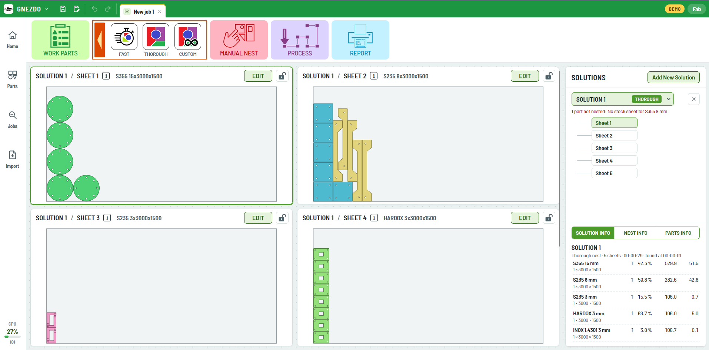
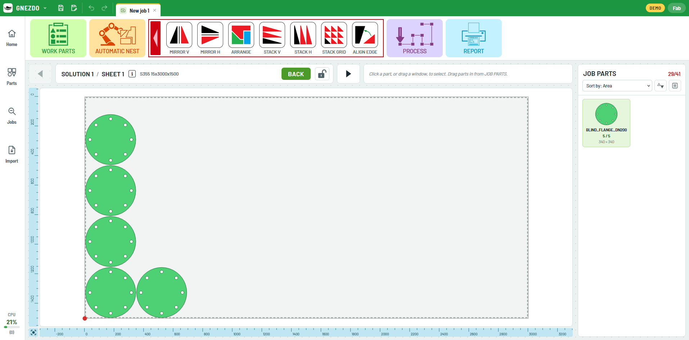
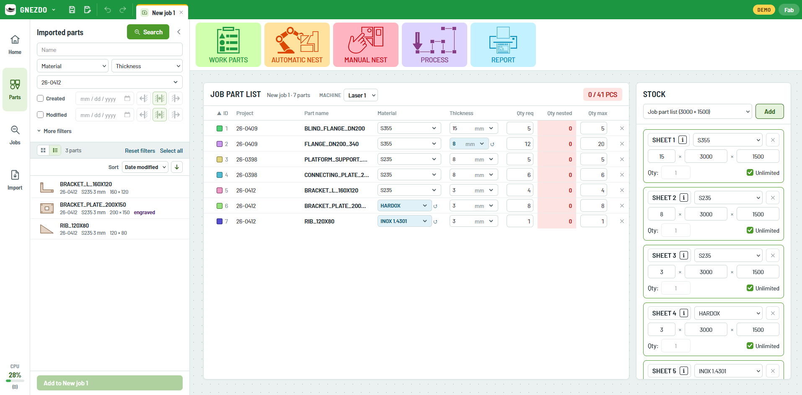

# GNEZDO

Laser nesting software A web app on the work server or a desktop version for windows and linux.
Users work in the browser; parts, jobs and nests live in SQL Server, or on personal pc if using desktop version.

I started the project because we are disappointed with the commercial software. It is expensive, fragile, and support is bad,... So i sad f-it im making my own software that i will actually enjoy using it.
Im building it from my experience using various nesting software over time.  Working as mechanical engineer in metal processing company  i tailoring it as i see it bets fits the workflow im using.. IT should suit not just hobbies but professional industrial environment  as well. 

I name it GNEZDO because all NEST  / NESTING are already used and i dont want my app to be another one  :D  [although GNEZDO means NEST in my language :)]

here is my ko-fi link if you want to support me in development

https://ko-fi.com/m0ti0n

https://paypal.me/FabG03D

https://buymeacoffee.com/M0ti0n

For more info you can reach me on mail fab.go3d@gmail.com

## GNEZDO – Application Screenshots

### JOB – AUTO NESTING



Automatically arranges imported parts onto available material sheets to optimize material utilization and minimize waste. Supports multiple nesting strategies, including Fast, Thorough and Custom, to balance processing speed and nesting quality. Provides multiple sheet solutions with material usage statistics and nesting results for easy comparison.


### JOB – MANUAL NESTING



Provides an interactive workspace for manually positioning and arranging parts on material sheets. Includes tools for mirroring, rotating, arranging, stacking and aligning parts to achieve the desired layout. Gives users precise control over the nesting process while displaying available job parts and sheet dimensions.


### JOB – WORK PART LIST


Centralizes all parts assigned to a production job in one organized list. Allows users to review part names, materials, thicknesses, required quantities, nested quantities and maximum quantities. Supports filtering imported parts and assigning material sheets and stock dimensions before starting the nesting process.


### PART IMPORTER


Centralizes all parts assigned to a production job in one organized list. Allows users to review part names, materials, thicknesses, required quantities, nested quantities and maximum quantities. Supports filtering imported parts and assigning material sheets and stock dimensions before starting the nesting process.


### APP MODULES

| Folder | What | Language |
|---|---|---|
| `frontend/` | Screens: home, tabs, imported parts panel, job part list | TypeScript + React (Vite) |
| `backend/` | Web server and database: parts, imports, projects, jobs | C# / .NET 10, SQL Server |
| `nesting/` | Nesting engine kept at hand: PackingSolver with our fixes, and our hole-filling pre-pass ([nesting/README.md](nesting/README.md)); not called by the app yet | C++, Python |

Planned: DXF/DWG import worker (Python, ezdxf), connecting the nesting engine, postprocessor.

## Download a test build (Windows)

**[⬇ Download gnezdo-windows.zip](https://github.com/M0ti0n/GNEZDO/releases/download/test-build/gnezdo-windows.zip)**
(rebuilt on every change to `main`)

Unzip it, double-click `start.bat`, and open http://localhost:8090. Nothing to install. It runs as a
**demo** (sample data, nothing saved) until a SQL Server connection is put in `config.json` — see
[packaging/INSTALL.txt](packaging/INSTALL.txt).

## Test parts

**[⬇ Download TEST_PARTS_FOR_GNEZDO.7z](https://github.com/M0ti0n/GNEZDO/raw/main/test-parts/TEST_PARTS_FOR_GNEZDO.7z)**
(in [`test-parts/`](test-parts/))

DXF parts for trying the import: unpack the archive (7-Zip) and drop the folder on the Import panel.

## Run on the server (Docker)

```bash
cp .env.example .env     # set GNEZDO_DB to a new, empty database
docker compose up -d --build
# or, to try it with its own SQL Server and sample data:
#   set GNEZDO_DB to the "db" line and GNEZDO_SAMPLE_DATA=true in .env, then
docker compose --profile sqlserver up -d --build
```

Open `http://<server>:8080`. The API creates its tables on first start.

## Develop

```bash
# backend (needs .NET 10 SDK and a SQL Server; Development seeds sample data)
cd backend/src/Gnezdo.Api
dotnet run                       # http://localhost:5080
# connection string: appsettings.json, or env ConnectionStrings__Gnezdo

# frontend
cd frontend
npm install
npm run dev                      # http://localhost:5173, sample data built in
echo "VITE_USE_API=true" > .env.local   # use the backend instead (proxied to :5080)
```

Tests: `dotnet test backend/Gnezdo.slnx` with `GNEZDO_TEST_SQL` set to a SQL Server
connection string without a database name; every run uses and drops its own database.
GitHub Actions runs the frontend type-check/build, the backend tests on SQL Server, and
the Docker builds on every push.

## API (so far)

| Endpoint | Returns |
|---|---|
| `GET /api/parts?name=&material=&thicknessMm=&project=&description=&created=on:2026-10-24&modified=upTo:2026-10-24&xMin=&xMax=&yMin=&yMax=&engraved=true` | parts, newest change first (max 500) |
| `GET /api/parts/facets` | materials and thicknesses for the filter lists |
| `POST /api/parts/existing` | which of the given parts (project + name) are already in the database |
| `POST /api/parts` | save processed parts from the import screen; `replace` decides whether an existing part (same project and name) is overwritten, otherwise it is reported as `exists` |
| `GET /api/imports/recent`, `GET /api/imports` | import batches |
| `GET /api/jobs/recent` | latest changed jobs |
| `GET /api/jobs?name=&material=&thicknessMm=&project=&created=on:2026-10-24&modified=upTo:2026-10-24&part=` | job search: `project` = jobs containing parts of that project, `part` = jobs a part is used in |
| `GET /api/jobs/{id}/parts` | parts in a job with quantities |
| `GET /api/projects/recent` | projects by last activity |
| `GET /api/health` | `{ "status": "ok" }` |

Sorting (parts and jobs): `sort=name|created|modified|material|thickness|project`, `dir=asc|desc`
(default: modified, newest first). Jobs sort by the smallest material/thickness/project among their parts.

Date filters: `on:` that calendar day, `upTo:` up to and including that day, `from:` from that
day on; days are shop days (Europe/Ljubljana).


## Saved part geometry

`Part.Geometry` is JSON (`format: "gnezdo-part"`, `version: 2`, in mm, y up): the drawing's
`entities` (line, arc, circle, spline, each with its role) and the `operations` for path generation:

| op | what | leads | start / direction |
|---|---|---|---|
| `cut` | closed cutting contour (`outer: true` for the outside; `slow: true` = marked with the **Hole** tool: cut at slower speed by machines / post processors that can, e.g. plasma) | from the technology table | path generation |
| `openCut` | connected open cut lines, cut in one go inside the part | lead-in 0, lead-out 0: piercing exactly at one end | one of `ends`, chosen by the cut order rules on the sheet |
| `engrave` | tracing (engraving), a separate operation, not cut through | none | path generation (shortest travel) |

Entities keep their DXF colour (`color` / `rgb`) and the `slow` flag. Each machine decides what it
does with the operations: one that cannot engrave (e.g. plasma) skips `engrave` as if it were not
there; one without a slow mode cuts `slow` contours normally.

Parts saved before this (version 1) hold only the entity list with roles; the operations can be
rebuilt from the roles.

## Database updates (migrations)

The database is updated by EF Core migrations in `backend/src/Gnezdo.Api/Data/Migrations`.
On start GNEZDO applies the migrations that have not run yet, each in a transaction; existing parts,
jobs and projects are kept.

- **Changing the model** (entities or `GnezdoDb`): add a migration in the same branch. Without the
  dotnet tools on your PC: write the migration name (e.g. `AddSheetStock`) on the first line of
  `backend/migration-request.txt` and push; the *EF migration* workflow adds it and pushes it back.
  CI fails while the model has changes without a migration.
- **Databases from before migrations** (made with `EnsureCreated`, test data only): GNEZDO stops with a
  message on start. Drop that database once and start GNEZDO again.
- **Before updating the server**: back up the database. To see the SQL first:
  `dotnet ef migrations script --idempotent --project backend/src/Gnezdo.Api`.
